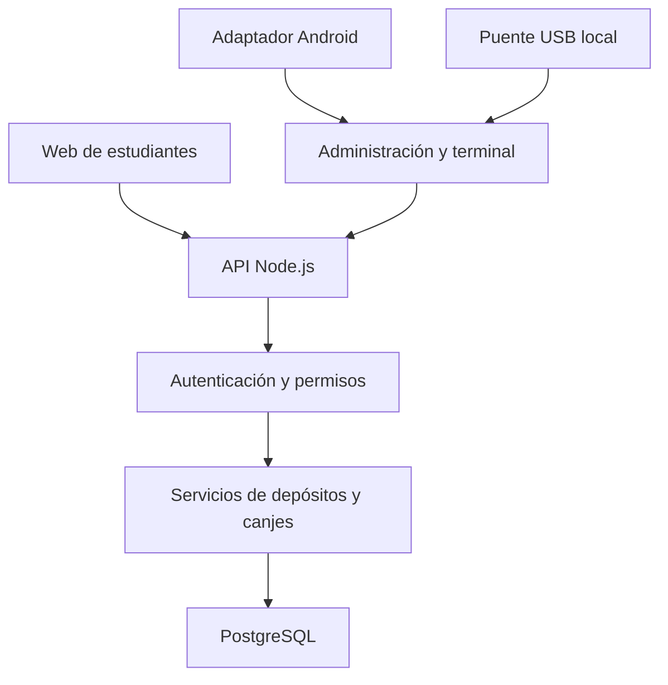

# Arquitectura de LEUMAG BANK

## Alcance y decisiones

Proyecto escolar con 56 estudiantes y moneda virtual sin conversión monetaria. La primera entrega permite evaluar las pantallas y el recorrido de atención. No es aún un sistema bancario operativo.

Proponemos un **monolito modular**: una aplicación Node.js que sirve la web y, en la siguiente etapa, una API conectada a PostgreSQL. Para este tamaño de grupo, una sola aplicación simplifica el aprendizaje, las sesiones, el despliegue y la investigación de errores. Cada responsabilidad se separa en módulos sin crear servicios innecesarios.

- **Interfaz:** HTML, CSS y JavaScript modular. Sin compilador ni framework en esta primera etapa, para poder leer directamente lo que hace cada archivo. Evaluar componentes adicionales solo si la complejidad futura lo justifica.
- **Servidor:** Node.js 24. Ahora solo sirve archivos; en la etapa 2, rutas HTTP, autenticación, validación, servicios de negocio y repositorios SQL separados.
- **Base de datos:** PostgreSQL como única fuente del saldo y del historial. No guardar saldos definitivos en el navegador o la tarjeta.
- **Moneda:** unidades enteras de LC. En PostgreSQL, BIGINT con límites de negocio y conversión explícita en la API; no usar números decimales de coma flotante para dinero.
- **Despliegue previsto:** servicio web y PostgreSQL en Railway. Una sola procedencia HTTPS para simplificar cookies y peticiones.
- **NFC:** adaptadores independientes. La pantalla de terminal recibe una referencia de tarjeta sin conocer cómo se leyó.

## Componentes previstos

El puente USB es un proceso futuro en el computador donde está conectado el lector. Railway no puede acceder directamente a ese puerto USB. El esquema no implica que cualquier lector sea compatible: se definirá el adaptador según modelo, sistema operativo y protocolo.

## Modelo de datos propuesto — todavía no creado

| Entidad | Campos principales | Reglas |
| --- | --- | --- |
| `usuarios` | id, nombre, alias, clave_hash, rol, estado | Alias único; ninguna contraseña en texto plano |
| `cuentas` | id, usuario_id, saldo_unidades, estado | Una cuenta por estudiante; saldo no negativo |
| `tarjetas` | id, cuenta_id, referencia_hash, origen, estado, fecha_bloqueo | Referencia única; solo una tarjeta activa por cuenta inicialmente |
| `actividades` | id, nombre, descripcion, monto_sugerido, estado | Montos sugeridos no autorizan depósitos automáticamente |
| `operaciones` | id, actor_id, clave_idempotencia, huella_solicitud, tipo, fecha, reversa_de | Clave única por actor; reintento idéntico devuelve el resultado original |
| `movimientos` | id, operacion_id, cuenta_id, monto_firmado, saldo_posterior, motivo | Registro permanente; depósito positivo y canje negativo |
| `recompensas` | id, nombre, precio_unidades, existencias, estado | Precio positivo, existencias no negativas |
| `canjes` | id, operacion_id, recompensa_id, precio_aplicado, estado_entrega | Guarda el precio del momento; entrega pendiente/entregada/cancelada |
| `sesiones` | id_hash, usuario_id, expira_en, revocada_en | Cookie de sesión, expiración y revocación |
| `auditoria` | id, actor_id, accion, entidad_id, fecha, detalle_minimo | Registra bloqueos, permisos y ajustes sin guardar secretos |
| `terminales` | id, nombre, estado, credencial_hash | Registro y revocación del dispositivo o puente |

No es una migración SQL: los nombres y restricciones se concretarán al implementar PostgreSQL. Para 56 cuentas, el historial podría calcular el saldo; se propone además un saldo materializado para simplificar la validación atómica. Ambos deben conciliarse y actualizarse en la misma transacción.

## Autorización prevista

| Acción | Estudiante | Docente administradora | Operador de terminal |
| --- | --- | --- | --- |
| Ver saldo e historial | Solo su cuenta | Todas las cuentas | Solo cuenta identificada durante atención |
| Consultar catálogo | Sí | Sí | Sí |
| Acreditar LC | No | Sí, con motivo | No |
| Iniciar solicitud de canje | Propia, si se habilita | Sí | En terminal autorizada |
| Aprobar canje | No por poseer la tarjeta | Sí | Sí, con sesión y alcance de terminal |
| Bloquear/reemplazar tarjetas | Solicitar bloqueo | Sí | No por defecto |
| Editar catálogo/cuentas/permisos | No | Sí | No |

El piloto puede funcionar solo con estudiante y docente; el rol operador se habilita si realmente hay encargados. Nunca aceptar el rol enviado por la pantalla como prueba de autorización.

## Recorrido seguro de un canje futuro

1. La docente u operador inicia sesión y abre una terminal autorizada.
2. El lector entrega una referencia; la API verifica tarjeta activa y cuenta habilitada. Identificar no realiza cobros.
3. La terminal muestra estudiante, recompensa, precio y saldo. El operador revisa y confirma.
4. El navegador envía `recompensaId`, referencia validada y una clave de idempotencia. El servidor obtiene el precio de su catálogo; no confía en el precio enviado por el cliente.
5. Dentro de una transacción PostgreSQL, se valida la sesión y se bloquean los registros afectados en orden consistente: cuenta, tarjeta y recompensa. Se comprueba nuevamente bloqueo, saldo, existencias y permisos.
6. Se descuenta saldo e inventario y se crean operación, movimiento y canje en la **misma transacción**. Ante un error, se revierte todo.
7. Solo después del COMMIT, la API responde aprobado. La pantalla reproduce animación y sonido, y muestra un comprobante identificable.

La idempotencia impide cobrar dos veces ante doble clic o reintento de red: la misma clave con el mismo contenido devuelve el resultado guardado; con contenido diferente devuelve conflicto. Ante desconexión no se aprueba localmente: se consulta la operación antes de reintentar. El bloqueo de tarjeta debe usar el mismo orden de bloqueos para que no compita de forma insegura con un canje.

Los errores se corrigen mediante movimientos compensatorios vinculados al original. No se borra ni modifica el historial. Se limitará a una reversión por operación, con saldo e inventario coherentes. La entrega física del premio tendrá su propio estado y responsable.

## API propuesta para etapa 2

| Método y ruta | Finalidad |
| --- | --- |
| `POST /api/sesiones`, `DELETE /api/sesiones/actual` | Iniciar y cerrar sesión |
| `GET /api/mi-cuenta`, `GET /api/mi-cuenta/movimientos` | Lecturas limitadas a la identidad autenticada |
| `GET /api/recompensas` | Catálogo activo |
| `GET /api/administracion/cuentas` | Listado autorizado |
| `POST /api/depositos` | Acreditar con motivo y clave de idempotencia |
| `POST /api/terminal/identificaciones` | Resolver tarjeta en terminal autenticada |
| `POST /api/canjes` | Ejecutar un canje autorizado e idempotente |
| `GET /api/operaciones/:id` | Consultar resultado con control de acceso |
| `POST /api/tarjetas/:id/bloqueo` | Bloquear y auditar |
| `POST /api/operaciones/:id/reversion` | Corregir sin borrar |

Actualmente **ninguna de estas rutas existe**. Solo se entregan archivos públicos y `GET /salud`.

## Organización del backend en la etapa 2

- `rutas/`: declara las direcciones HTTP.
- `controladores/`: traduce solicitud y respuesta.
- `validaciones/`: valida tipos, longitudes, montos e identificadores.
- `servicios/`: aplica reglas de depósitos, canjes y permisos.
- `repositorios/`: ejecuta consultas parametrizadas y transacciones SQL.
- `seguridad/`: sesiones, contraseñas, límites de intentos y CSRF.
- `base-datos/migraciones/`: cambios de estructura versionados.

Crear estos módulos al implementar sus responsabilidades, evitando archivos vacíos que parezcan funciones ya terminadas.

## Seguridad y operación antes del piloto

Cookies HttpOnly, Secure y SameSite; protección CSRF en mutaciones; hash de contraseñas con un algoritmo apropiado y parámetros revisados; límites de intentos; roles verificados por petición; consultas parametrizadas; secretos en variables de entorno; HTTPS; auditoría mínima. El UID o el contenido NDEF identifican, pero pueden copiarse: nunca sustituyen una sesión autorizada. Un PIN de estudiante podría agregarse si el contexto lo requiere, con hash y límite de intentos.

No publicar nóminas, UIDs reales, contraseñas o volcados de base de datos en GitHub. Preparar respaldo y probar restauración, exportación docente de movimientos, y prueba de concurrencia sobre la misma cuenta y la última unidad de un premio. Validar el flujo con pocas cuentas de prueba antes de ingresar las 56 definitivas.

## Etapas y criterios de cierre

| Etapa | Entrega | Criterio de cierre |
| --- | --- | --- |
| 1 · Actual | Diseño, simulación, arquitectura y código legible | Docente revisa vistas, textos y recorrido; revisión visual en navegador pendiente |
| 2 | Sesiones, roles, PostgreSQL y monederos | Persistencia tras reinicios; acceso ajeno denegado; conciliación de saldos |
| 3 | Depósitos, catálogo, canjes y auditoría | Sin doble cobro, sin saldo/stock negativo, reversas trazables |
| 4 | Android y tarjetas físicas | Compatibilidad verificada, lectura repetible y bloqueo efectivo |
| 5 | USB y piloto | Lector específico probado; dispositivo revocable; restauración y concurrencia verificadas |

Fuentes técnicas: [bloqueos en PostgreSQL](https://www.postgresql.org/docs/current/explicit-locking.html), [Web NFC en Chrome](https://developer.chrome.com/docs/capabilities/nfc), [MIFARE Classic en Android](https://developer.android.com/reference/android/nfc/tech/MifareClassic).
